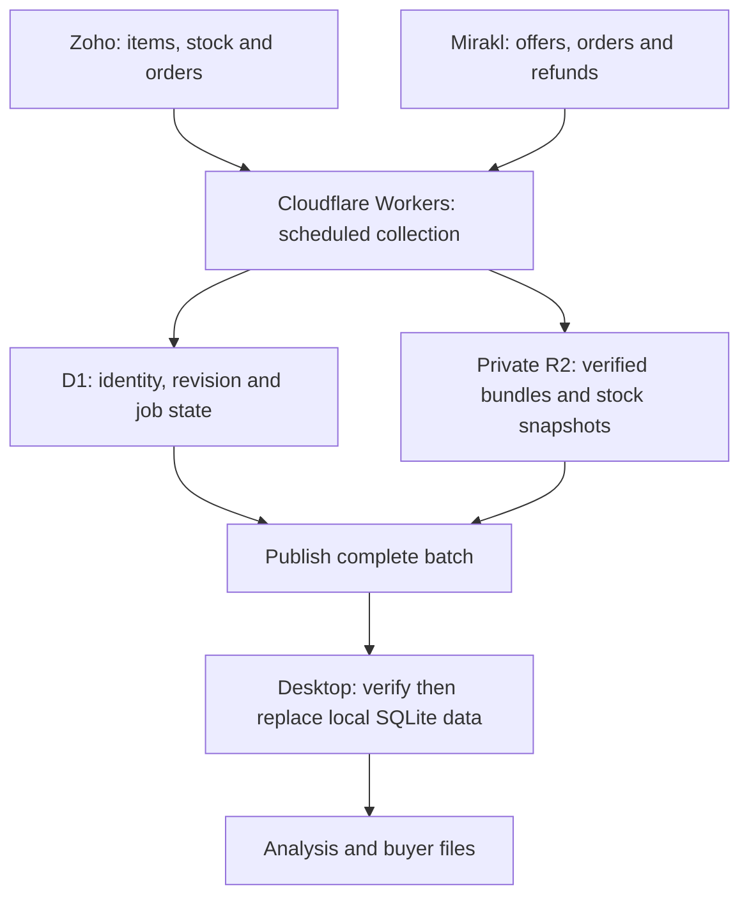

# A shared collection layer, a local analysis tool

This is an explanation of the design behind my commerce workbench. The runnable example models publication and verification; it does not contain the private service or desktop application.

## Decision 1 — read the systems that own the records

Repeated spreadsheet exports lose stable IDs and are difficult to reconcile. APIs expose authoritative records and pagination. Before connecting a service I establish which objects and fields it owns, prove read access, map exact identifiers and compare a sample against the original system. API access alone is not proof of data parity.

## Decision 2 — collect once, independently of each desktop

Workers can run shared collection jobs without requiring every colleague's laptop to be open or every user to configure source credentials. D1 records job and revision state; private R2 stores the larger bundles. A job must finish its pages and pass count/identity checks before a new batch is advertised.

The tradeoff is another service to operate: authentication, retries, scheduled-job health and storage retention need explicit ownership. A shared layer is justified by repeated multi-user collection, not simply because cloud infrastructure is fashionable.

## Decision 3 — keep history deliberately

Sales and ledger records use stable identities and changed versions to reduce repeated storage and downloads. Daily stock snapshots remain because they answer historical stock questions. Temporary job fragments expire after seven days. This does not claim upstream APIs became incremental: a full reconciliation can still generate a small downstream delta.

## Decision 4 — a bad update must not replace a good one

The desktop checks the base revision, record count and checksum before replacing local data. On failure it keeps the prior verified batch and requests a correct delta or baseline. [verified_sync.py](../examples/verified_sync.py) demonstrates this contract, including explicit deletions.

Production work additionally needs atomic database transactions, revision concurrency checks, permission-scoped endpoints, integrity/signature checks and retained failure telemetry. The in-memory example is intentionally smaller than that system.
